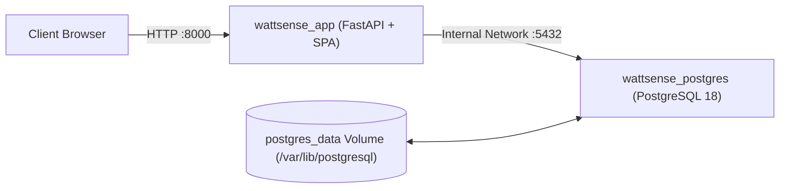

# WattSense AI™ — Docker Deployment Architecture

## 1. Overview

WattSense AI™ features an isolated, multi-stage Docker deployment that bundles the React 19 Single Page Application and the FastAPI asynchronous backend into a unified, high-performance container image served alongside an official PostgreSQL 18 database service.

```text
deployment/
├── docker/
│   └── README.md                      <- Docker operations guide
└── nginx/
    └── wattsense_production.conf      <- Production TLS 1.3 reverse proxy configuration
```

---

## 2. Container Architecture



### Key Engineering Safeguards:
1. **Multi-Stage Build**:
   - **Stage 1 (Frontend Builder)**: Uses `node:20-alpine` to compile the React 19 Single Page Application with Vite 8.
   - **Stage 2 (Production Runtime)**: Uses `python:3.12-alpine` to install lean production dependencies and serve the pre-compiled frontend assets directly via FastAPI static file mounting.
2. **Non-Root Execution**:
   - Container executes under an unprivileged system user (`appuser:appgroup`, UID/GID 10001).
3. **Database Volume Mounting**:
   - PostgreSQL 18 Alpine cluster layout requires mounting persistent volumes at `/var/lib/postgresql` rather than `/var/lib/postgresql/data`.
4. **Safe Initial Seed**:
   - Container database initializes from the verified snapshot (`01_init.sql`) ensuring all 1,024 records and 3 demonstration customers exist upon first boot.

---

## 3. Operational Commands

### Start All Services (Detached Mode)
```bash
docker compose up -d
```

### Inspect Container Health
```bash
docker ps
```

### Run Live Integration Verification
```bash
python backend/scripts/test_live_docker_deployment.py
```

### Graceful Teardown
```bash
docker compose down
```

---

## 4. Production Readiness Boundary

- **Verified Scope**: Multi-container Docker deployment is 100% verified on local loopback (`http://127.0.0.1:8000`). All 11 healthcheck and API integration tests pass.
- **Pending Scope**: Public cloud hosting (AWS ECS / GCP Cloud Run), managed cloud database clustering (Aurora / Cloud SQL), and cloud secret rotation remain future milestones.
