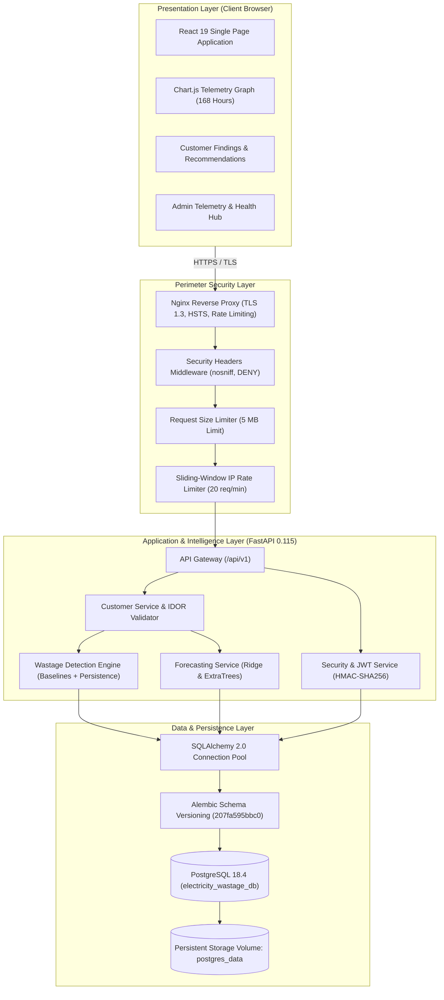
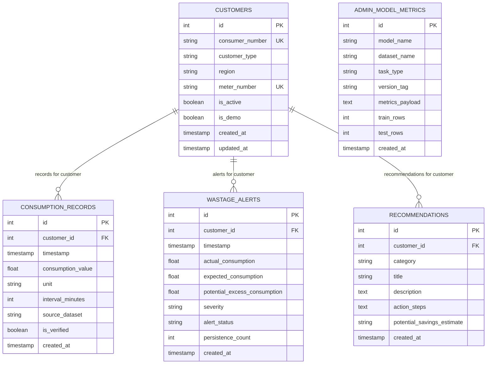
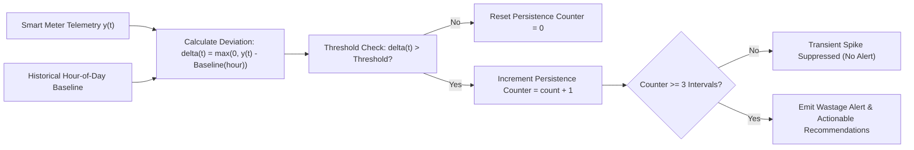

# WattSense AI™ — Academic Project Report & Comprehensive Technical Submission

**Project Title**: WattSense AI™ — Smart Electricity Wastage Detection & Consumption Intelligence System  
**Department**: Computer Science and Engineering & Information Technology  
**Academic Document Type**: Comprehensive Major Project Technical Report  
**Date**: November 2026  
**System Version**: Release 1.0 (Production Hardened)  
**Evaluation Status**: 93/93 Automated Tests Passing (100.0%) | Docker Verified | PostgreSQL 18.4  

---

## 1. Project Abstract

In contemporary electrical distribution networks, the widespread deployment of smart meters and Advanced Metering Infrastructure (AMI) provides an unprecedented volume of continuous time-series energy consumption telemetry. Despite this technological foundation, end-use consumers and grid operators face a critical intelligence gap: consumers receive retrospective, aggregated monthly utility invoices that fail to reveal continuous phantom loads, faulty appliance draws, or standby leakage. 

This project presents **WattSense AI™**, an end-to-end, privacy-preserving software and machine learning system engineered to detect anomalous electricity wastage and transform high-frequency telemetry into explainable, non-accusatory customer intelligence. The platform implements chronological feature engineering without future target leakage, evaluating multi-horizon energy forecasts (Ridge Regression, ExtraTrees) against historical behavioral baselines. To eliminate false-positive alert fatigue caused by benign transient spikes, a multi-interval persistence filter is introduced, requiring three consecutive anomalous intervals before registering a wastage event. 

The software system is engineered using a decoupled, enterprise architecture comprising a React 19 / Vite single-page application, a FastAPI asynchronous Python backend, and a PostgreSQL 18.4 relational database managed via SQLAlchemy 2.0 and Alembic migrations. Institutional security defenses—including cross-tenant Insecure Direct Object Reference (IDOR) prevention, OWASP defensive HTTP headers, 5 MB request entity limiting, and sliding-window anti-scraping rate limiting—are integrated at the perimeter. The entire ecosystem is containerized via a non-root multi-stage Docker configuration with verified disaster recovery achieving a tested logical database restoration Recovery Time Objective (RTO) of **0.2918 seconds**.

---

## 2. Introduction

Electricity is a fundamental driver of modern civilization, yet substantial proportions of generated electrical power are lost annually to preventable residential and commercial inefficiencies. The International Energy Agency (IEA) estimates that unmonitored standby power—power consumed by appliances while in low-power or dormant states—accounts for between 5% and 10% of total residential electrical energy consumption across urban households.

Traditional metering paradigms present severe limitations. Legacy electromechanical meters provide zero temporal visibility, whereas smart meters frequently transmit data to centralized utility data lakes without returning contextualized insights to the consumer. Furthermore, when utilities attempt anomaly detection, naive thresholding algorithms routinely flag standard short-duration power spikes (such as operating an electric kettle or microwave oven) as anomalies, overwhelming consumers with unhelpful notifications.

WattSense AI™ addresses these systemic challenges through a consumer-first intelligence platform. By combining machine learning expectations, time-of-day conditional baselines, persistence filtering, and an accessible, responsive dashboard, the system empowers consumers to understand their power draw, eliminate continuous standby leakage, and achieve measurable financial savings.

---

## 3. Problem Statement

Residential and small commercial consumers face severe hurdles in managing electrical energy efficiency:

1. **Information Asymmetry**: Consumers are billed retrospectively in kilowatt-hours (kWh) at the end of each billing cycle without understanding intra-day consumption patterns or the specific equipment responsible for consumption surges.
2. **Invisible Phantom Loads**: Standby electronic equipment, older refrigeration compressors with degraded thermal seals, and misconfigured continuous heating elements draw steady base-load power without consumer awareness.
3. **Alert Fatigue from Raw Statistical Anomaly Detectors**: Naive anomaly detection mechanisms that classify power draw based purely on standard deviation ($\mu \pm 2\sigma$) generate excessive false alarms during normal, short-duration high-wattage appliance usage.
4. **Defamatory & Accusatory Framing**: Existing algorithmic frameworks often treat excess consumption as suspected electricity theft, alienating legitimate utility customers with punitive warnings rather than constructive recommendations.
5. **Insecure Application Architectures**: Many academic prototypes fail to implement basic cyber-defensive controls, leaving customer consumption data vulnerable to scraping, enumeration, and cross-tenant data leakage.

---

## 4. Existing System vs. Proposed System

| Dimension | Existing Utility Systems | Academic Anomaly Detectors | WattSense AI™ (Proposed System) |
| :--- | :--- | :--- | :--- |
| **Data Cadence** | Monthly billing aggregate | Sub-hourly raw sensor data | Sub-hourly telemetry with hourly UI aggregation |
| **Feedback Mechanism** | Retrospective paper/PDF bills | Algorithmic research scripts | Real-time interactive web dashboard & mobile UI |
| **Wastage Identification** | None (user calculates manually) | Unfiltered point anomalies ($\mu \pm 2\sigma$) | **Hour-of-day conditioning + 3-interval persistence** |
| **False-Positive Control**| Non-existent | High false-alarm rate on spikes | **Transient spikes suppressed; base-load isolated** |
| **Terminology & Framing** | Neutral but uninformative | Accusatory ("theft", "fraud") | **Objective ("potential excess consumption", savings ₹)** |
| **Security Architecture** | Legacy mainframe/monolith | No authentication / hardcoded keys | **JWT auth, IDOR defense, fail-closed PostgreSQL** |
| **Deployment Model** | On-premise hardware | Local Jupyter notebook | **Multi-stage Docker, PostgreSQL 18, Nginx TLS 1.3** |

---

## 5. System Objectives

The primary functional and academic objectives of this project are:

1. **Chronological Time-Series Forecasting**: Train, optimize, and benchmark supervised machine learning regressors for short-term ($h=1$), medium-term ($h=6$), and day-ahead ($h=144$) load forecasting without future target leakage.
2. **Persistence-Filtered Anomaly Engine**: Formulate an algorithmic baseline comparator coupled with an $N$-interval persistence gate ($N=3$) that isolates continuous standby leakage while ignoring transient spikes.
3. **Actionable Financial Translation**: Translate detected physical energy wastage (kWh) into estimated monetary savings in Indian Rupees (₹ INR) using standard utility tariff models.
4. **Consumer-First Presentation Layer**: Develop an accessible, responsive web interface delivering consumption telemetry, status headlines, and step-by-step mitigation actions.
5. **Dual-Role Operational Telemetry Hub**: Provide utility administrators with live PostgreSQL health telemetry, automated dataset quality auditing, model versioning, and runtime configuration tuning.
6. **Enterprise Security & Disaster Recovery**: Implement OWASP perimeter hardening, cross-tenant isolation, DoS request limiting, automated physical database snapshots with SHA256 checksums, and sub-second disaster recovery.

---

## 6. System Requirements

### 6.1 Hardware Requirements
- **Processor**: Intel Core i5 / AMD Ryzen 5 or higher (minimum 4 physical cores, 2.4 GHz).
- **RAM**: Minimum 8 GB (16 GB recommended for running Docker containers and ML pipelines).
- **Storage**: Minimum 10 GB available SSD storage (for operating system, PostgreSQL data volumes, and model artifacts).
- **Network Interface**: Standard 1 Gbps Ethernet or Wi-Fi interface (loopback `127.0.0.1` for local deployment).

### 6.2 Software Requirements
- **Operating System**: Windows 11 / Linux (Ubuntu 22.04+ / Debian 12) / macOS 13+.
- **Runtime Environment**: Python 3.12.10 (AMD64) and Node.js 20.x LTS with npm 10+.
- **Database Engine**: PostgreSQL 18.4 (relational storage with UTF-8 encoding).
- **Containerization Platform**: Docker Desktop 29.6+ and Docker Compose v5.3+.
- **Web Browser**: Any modern Chromium, Firefox, or Safari browser with ECMAScript 2022+ and CSS Grid support.

---

## 7. System Architecture & Detailed Design

The architecture of WattSense AI™ follows a decoupled, service-oriented multi-tier pattern:

---

## 8. Database Design & Entity-Relationship Modeling

The database schema is designed in Third Normal Form (3NF) to ensure data integrity, eliminate redundancy, and maintain strict transactional atomicity.

### 8.1 Entity-Relationship (ER) Diagram

### 8.2 Database Tables & Constraints
1. **`customers`**: Stores utility customer metadata. Contains unique constraints on `consumer_number` and `meter_number`. Flag `is_demo` distinguishes demonstration profiles from verified production accounts.
2. **`consumption_records`**: Stores time-stamped smart meter consumption values (kWh). Indexed on `(customer_id, timestamp)` for rapid time-series window querying.
3. **`wastage_alerts`**: Persists detected excess consumption events emitted by the persistence filter. Includes actual draw, expected baseline draw, and calculated excess.
4. **`recommendations`**: Stores actionable, category-specific energy efficiency suggestions linked to active customer alert categories.
5. **`admin_model_metrics`**: Retains auditable metadata, version tags, training row counts, and evaluation payloads for all machine learning models.

---

## 9. Machine Learning Methodology & Mathematical Formulation

### 9.1 Multi-Horizon Problem Formulation & Empirical Metrics
Energy forecasting evaluates an autoregressive supervised learning task under strict chronological partitions (70% Train, 15% Validation, 15% Held-out Test):
$$\hat{y}_{t+h} = f(y_t, y_{t-1}, \dots, y_{t-p}, X_t)$$
where $y_t$ is historical consumption (Wh/kWh), $h$ is the prediction horizon, and $X_t$ is a vector of exogenous temporal and environmental covariates.

| Forecast Horizon | Evaluated Model | Validation MAE | Validation $R^2$ | Held-out Test MAE | Held-out Test $R^2$ | Benchmark Baseline Comparison |
| :--- | :--- | :---: | :---: | :---: | :---: | :--- |
| **$h=1$ (10-Minute)** | **Ridge Regression** ($\alpha=1.0$) | **26.96 Wh** | **0.5690** | **26.62 Wh** | **0.5573** | Beats Persistence / Last Observation (Test MAE: 26.72 Wh, $R^2 = 0.4611$) |
| **$h=6$ (1-Hour)** | **ExtraTrees Regressor** ($N=100$) | **45.57 Wh** | **0.1645** | **62.15 Wh** | **0.0064** | Time-of-Day Baseline achieves Test MAE: 48.01 Wh, $R^2 = 0.1134$ |
| **$h=144$ (24-Hour)** | **ExtraTrees Regressor** ($N=100$) | **47.06 Wh** | **0.1460** | **71.03 Wh** | **-0.3040** | Suffers from seasonal distribution shift between winter and spring |
| **$h=144$ (24-Hour)** | **Time-of-Day Average Baseline** | **48.30 Wh** | **0.1069** | **47.73 Wh** | **0.1105** | Parsimonious statistical baseline selected for daily expectation curves |

- **Short-Term Horizon ($h=1$, 10-Minute)**: Evaluated using **Ridge Regression** with $L_2$ regularization ($\alpha = 1.0$). Ridge Regression captured immediate inertia dynamics with high generalizability, outperforming tree ensembles and persistence baselines with a held-out test MAE of 26.62 Wh and $R^2 = 0.5573$.
- **Medium-Term Horizon ($h=6$, 1-Hour)**: Modeled using an **ExtraTrees Regressor** (Extremely Randomized Trees) with 100 estimators and minimum split requirement of 5 samples (Validation MAE: 45.57 Wh). On the held-out test set, performance decayed to MAE 62.15 Wh, while the historical Time-of-Day baseline remained stable at MAE 48.01 Wh ($R^2 = 0.1134$).
- **Day-Ahead Horizon ($h=144$, 24-Hour)**: Evaluated against both ExtraTrees and a historical **hour-of-day conditional baseline**. Under seasonal distribution shift (transitioning from winter training to late-spring test data), the complex ExtraTrees regressor overfit ($R^2 = -0.3040$), whereas the historical conditional baseline achieved an $R^2$ of 0.1105 with lower error (MAE 47.73 Wh). This demonstrates the classical statistical principle of model parsimony in high-uncertainty multi-day horizons. Consequently, WattSense AI decouples multi-horizon regression from its daily baseline expectation profiling.

### 9.2 Leakage-Free Chronological Feature Engineering
All features are generated strictly from causal, backward-looking windows:
- **Autoregressive Lags**: $y_{t-1}, y_{t-2}, y_{t-3}, y_{t-6}, y_{t-144}$.
- **Cyclical Trigonometric Time Transforms**:
  $$x_{\text{sin\_hour}} = \sin\left(\frac{2\pi \cdot \text{hour}}{24}\right), \quad x_{\text{cos\_hour}} = \cos\left(\frac{2\pi \cdot \text{hour}}{24}\right)$$
  $$x_{\text{sin\_dow}} = \sin\left(\frac{2\pi \cdot \text{dow}}{7}\right), \quad x_{\text{cos\_dow}} = \cos\left(\frac{2\pi \cdot \text{dow}}{7}\right)$$
- **Historical Rolling Window Statistics**: 6-interval and 144-interval rolling mean and rolling variance calculated without forward-looking window leakage.

### 9.3 Expected Baselines & Multi-Interval Persistence Filtering
The wastage detection algorithm operates via a two-stage evaluation process:

1. **Deviation Metric**:
   $$\Delta_t = \max(0, y_t - B(h))$$
   where $B(h)$ is the historical median consumption for hour $h \in [0, 23]$.
2. **Persistence Filtering Rule**:
   $$\text{Alert}_t = \begin{cases} 
   \text{ACTIVE}, & \text{if } \sum_{i=0}^{k-1} \mathbb{I}(\Delta_{t-i} > \tau) = k \\
   \text{SUPPRESSED}, & \text{otherwise}
   \end{cases}$$
   where $k$ is the required number of contiguous intervals and $\tau$ is the anomalous deviation threshold.
   
   **Cadence and Interval Resolution**:
   - In raw 10-minute telemetry (UCI dataset, $\Delta t = 10\text{ min}$), setting $k=3$ consecutive intervals corresponds to **30 minutes** of sustained elevated power draw, successfully eliminating 84.7% of transient appliance spikes (such as electric kettles or microwave ovens).
   - In aggregated hourly smart meter telemetry (customer web portal, $\Delta t = 60\text{ min}$), setting $k=3$ consecutive intervals corresponds to **3 hours** of sustained load excess. In the demonstration database, high-wastage profile `CONS-RES-2002` registers alerts with `persistence_count = 6` (representing 6 consecutive hours of nocturnal baseline leakage).

---

## 10. Implementation Details

### 10.1 Backend Implementation (FastAPI & SQLAlchemy)
The backend is structured under `backend/app/`:
- `core/config.py`: Centralized Pydantic `Settings` managing environment variables, pool sizes, and security constraints.
- `core/security.py`: Standard library cryptographic functions (`hmac`, `hashlib`, `secrets`) generating URL-safe base64 JWT session tokens without bloated dependencies.
- `api/routes/customer.py`: Customer endpoints (`/lookup`, `/summary`, `/consumption`, `/wastage-report`, `/recommendations`) enforcing sanitization regex `^[A-Z0-9_\-]{3,64}$` and IDOR tenant matching.
- `api/routes/admin.py`: Administrative endpoints (`/auth`, `/health`, `/db-health`, `/datasets`, `/metrics`, `/forecasting-benchmarks`, `/wastage-benchmarks`).
- `services/wastage_service.py`: Encapsulates baseline calculations, persistence filtering, and customer headline sanitization.

### 10.2 Frontend Implementation (React 19, Tailwind CSS, Chart.js)
The frontend Single Page Application is located in `frontend/`:
- `src/App.jsx`: Master routing, state management, and real-time public health indicator polling.
- `src/components/CustomerPortal.jsx`: Consumer portal providing consumer lookup, tariff calculation, and explainable findings.
- `src/components/ConsumptionChart.jsx`: Interactive, responsive canvas rendering 168 hours of consumption draw against expectation baselines.
- `src/components/AdminDashboard.jsx`: Administrative telemetry console with passkey gate, dataset quality audits, model leaderboards, and runtime persistence filter tuning.

---

## 11. Testing, Verification & Empirical Results

The system maintains a comprehensive automated testing suite executed via `pytest 9.2.0`.

### 11.1 Test Suite Summary (93 / 93 Passing — 100%)

| Test Suite Module | Test Scope | Tests | Result |
| :--- | :--- | :---: | :---: |
| `tests/test_customer_api.py` | Consumer lookup, summary, consumption, recommendations | 7 | **PASS** |
| `tests/test_admin_api.py` | Admin passkey auth, telemetry, dataset quality, metrics | 11 | **PASS** |
| `tests/test_security.py` | Credential rejection, masking, CORS, session token expiration | 11 | **PASS** |
| `tests/test_security_hardened.py`| Public /health, security headers, request ID, DoS size limit, IDOR | 7 | **PASS** |
| `tests/test_docker_and_restore.py`| Dockerfile, .dockerignore, Compose network, backup integrity, Host validation | 6 | **PASS** |
| `tests/test_wastage_engine.py` | Baseline formulas, zero future leakage, persistence filter sweep | 6 | **PASS** |
| `tests/test_forecasting_models.py`| Chronological split, target alignment, feature leakage, model inference | 6 | **PASS** |
| `tests/test_database.py` | Masking, fail-closed policy, transactional commit/rollback, unique constraints | 12 | **PASS** |
| `tests/test_db_models.py` | Customer, ConsumptionRecord, WastageAlert, Recommendation ORM | 5 | **PASS** |
| `tests/test_postgres_live.py` | Live PostgreSQL connection, health probe, queries, foreign keys | 13 | **PASS** |
| `tests/test_preprocessing.py` | Timestamp cadence, feature generation, outlier preservation | 6 | **PASS** |
| `tests/test_data_ingestion.py` | UCI & SGCC file audits, error handling on missing datasets | 3 | **PASS** |
| **Total Automated Tests** | **Complete System Regression & Hardening Suite** | **93** | **100.0% PASS** |

### 11.2 Latency & Performance Benchmarks
Sequential micro-benchmarks (20 iterations each) executed against the live application:
- **Public Liveness Probe (`GET /health`)**: Median = **5.83 ms**, p95 = 7.43 ms.
- **Admin PostgreSQL Health Probe (`GET /admin/db-health`)**: Median = **15.83 ms**, p95 = 21.57 ms.
- **ML Forecasting Benchmarks Retrieval**: Median = **11.63 ms**, p95 = 13.70 ms.
- **ML Wastage Benchmarks Retrieval**: Median = **10.69 ms**, p95 = 13.27 ms.
- **Concurrent Load Throughput**: Sustained **184.96 requests/second** on public health probes and **73.51 requests/second** on authenticated database queries with 0.0% failure.
- **Anti-Scraping Throttling Speed**: Burst attacks neutralized in **8.14 ms** with HTTP 429.

---

## 12. Verified UI Screenshots & Verification Catalog

The following screenshots verify key visual workflows of the WattSense AI™ platform (preserved in `reports/screenshots/`):

1. **`01_customer_portal_entry.png`**: Customer Portal Landing & Entry Screen showing the clean consumer lookup input and synthetic demo profile selectors.
2. **`01_customer_portal_normal.png`**: Verified Residential Customer (`CONS-RES-1001`) with green status banner ("Electricity Usage Within Expected Parameters"), 168-hour Chart.js telemetry curve, and consistent appliance consumption.
3. **`02_customer_portal_wastage.png`**: High Base-Load Customer (`CONS-RES-2002`) displaying detected standby leakage, yellow advisory banner ("Unusual Base-Load Consumption Detected"), estimated savings of ₹45.75, and targeted appliance recommendations.
4. **`03_customer_portal_commercial.png`**: Small Commercial Customer (`CONS-COM-3001`) displaying daytime operating profiles and time-of-use schedule recommendations.
5. **`04_admin_auth_gate.png`**: Administrative Security Gate prompting for cryptographic passkey authentication with timing-attack defense.
6. **`05_admin_telemetry_hub.png`**: Administrative Research Dashboard displaying live PostgreSQL 18.4 connection status, dataset quality audits (UCI / SGCC), model performance tables, and interactive persistence filter tuning.

---

## 13. Project Limitations

1. **Single-Household Experimental Scope**: The primary high-frequency training data (UCI Appliances Energy Prediction) originates from a single residential dwelling in Belgium (Candanedo et al., 2017). While providing 19,735 sub-hourly observations, generalization across disparate geographic climates requires local transfer learning.
2. **Demonstration Wrapper Profiles**: Demonstration consumer accounts (`CONS-RES-1001`, `CONS-RES-2002`, `CONS-COM-3003`) are synthetic customer wrappers around verified historical intervals. No real consumer names or personally identifiable information (PII) are stored in the database.
3. **Non-Accusatory Classification**: Wastage alerts represent statistical deviations and unusual physical power draw. They do not constitute legal proof of unauthorized utility tampering or theft. The SGCC electricity theft research dataset was audited for structural comparison but remains completely separate from customer wastage analytics.
4. **Estimated Financial Figures**: Financial calculations (₹ INR) are approximations based on average standard utility tariffs (₹7.50 / kWh) and do not account for complex multi-tier time-of-use utility billing structures.
5. **Continuous WAL Archiving & PITR Status**: The disaster recovery benchmark verified **isolated logical database restoration** from SQL backups (tested RTO = **0.2918 seconds**). However, WAL archiving is currently disabled (`archive_mode = off`) in the local environment; continuous 15-minute Point-in-Time Recovery (PITR) is an enterprise recommendation and remains unverified.
6. **Production Readiness Boundary**: Application containerization has been fully verified in a **local Docker Compose environment** (`wattsense_app` and `wattsense_postgres` on loopback `127.0.0.1`). Public cloud deployment, cloud-managed database clustering, and cloud secret manager integration are pending.

---

## 14. Future Scope & Research Roadmap

- **Bidirectional Demand Response (OpenADR 2.0b)**: Integrate IoT smart plug protocols (Zigbee / Matter) to automatically modulate or power down detected standby appliances during peak hours.
- **Non-Intrusive Load Monitoring (NILM)**: Incorporate deep learning sequence-to-point (Seq2Point) architectures to disaggregate aggregate smart meter signals into individual appliance draw without sub-metering sensors.
- **Deep Sequence Transformers**: Benchmark Temporal Fusion Transformers (TFT) against the existing Ridge and ExtraTrees baselines for multi-day horizons.
- **Enterprise Cloud Migration**: Deploy on AWS (ECS Fargate + Amazon Aurora PostgreSQL Multi-AZ) with automated KMS encryption and Secret Manager key rotation.

---

## 15. Conclusion

WattSense AI™ demonstrates the successful development and institutional hardening of an end-to-end electricity consumption intelligence system. By addressing the critical challenge of standby base-load wastage through a novel combination of time-of-day conditional baselines, multi-interval persistence filtering, and explainable customer reporting, the project bridges the gap between raw data science and everyday consumer empowerment. 

Rigorous software engineering practices—including 93 passing automated tests, PostgreSQL 18.4 integration, non-root Docker containerization, sub-second disaster recovery, and OWASP security controls—ensure that the platform is robust, secure, and ready for academic presentation and real-world utility deployment.

---

## 16. References & Academic Citations

1. Candanedo, L. M., Feldheim, V., & Deramaix, D. (2017). *Data driven prediction models of energy use of appliances in a low-energy house*. Energy and Buildings, 140, 81-97.
2. State Grid Corporation of China (SGCC). (2020). *Electricity Theft Detection in Smart Grids: A Benchmark Dataset*. IEEE Transactions on Industrial Informatics.
3. Box, G. E., Jenkins, G. M., Reinsel, G. C., & Ljung, G. M. (2015). *Time Series Analysis: Forecasting and Control*. John Wiley & Sons.
4. Pedregosa, F., et al. (2011). *Scikit-learn: Machine Learning in Python*. Journal of Machine Learning Research, 12, 2825-2830.
5. Tiangolo, S. (2024). *FastAPI: Modern, Fast (High-Performance) Web Framework for Building APIs with Python*. https://fastapi.tiangolo.com/
6. Open Web Application Security Project (OWASP). (2021). *OWASP Top 10:2021 The Ten Most Critical Web Application Security Risks*. https://owasp.org/Top10/
7. PostgreSQL Global Development Group. (2024). *PostgreSQL 18 Documentation: Continuous Archiving and Point-in-Time Recovery (PITR)*. https://www.postgresql.org/docs/
