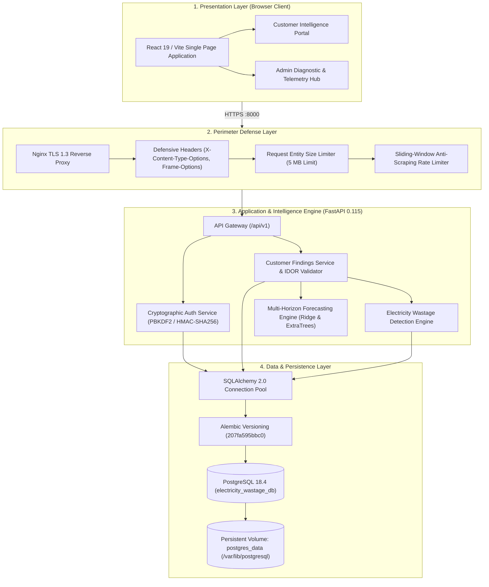
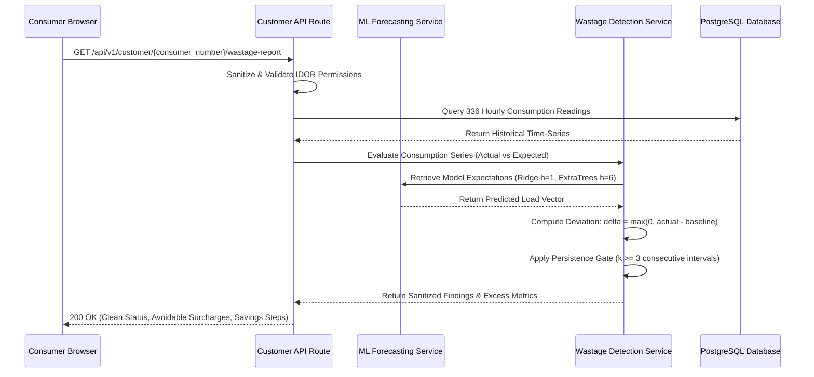

# WattSense AI™ — System Architecture & Detailed Design

**Document Reference**: `WATT-DOCS-ARCH-2026`  
**System Version**: 1.0.0  

---

## 1. High-Level Architectural Pattern

WattSense AI™ is engineered using a decoupled, multi-tier service-oriented architecture comprising four primary tiers:
1. **Presentation Tier**: React 19 Single Page Application (SPA) bundled via Vite 8.
2. **Security & Perimeter Tier**: Nginx Reverse Proxy, security headers middleware, request entity size limiter (5 MB), and IP rate limiter.
3. **Application & Intelligence Tier**: FastAPI asynchronous Python 3.12 backend managing business logic, machine learning inference, and wastage detection.
4. **Data & Persistence Tier**: PostgreSQL 18.4 relational storage managed via SQLAlchemy 2.0 ORM and Alembic schema migrations.

---

## 2. Decoupled Intelligence & Detection Flow

The machine learning and anomaly detection engine operates through a two-stage decoupled pipeline:

---

## 3. Deployment Boundaries

- **Local Verification**: The entire architecture is packaged into a multi-stage Docker Compose deployment on loopback `127.0.0.1:8000`.
- **Cloud Readiness**: Service boundaries and stateless backend design enable zero-code container deployment to AWS ECS (Fargate) or GCP Cloud Run with Amazon Aurora or Google Cloud SQL.
