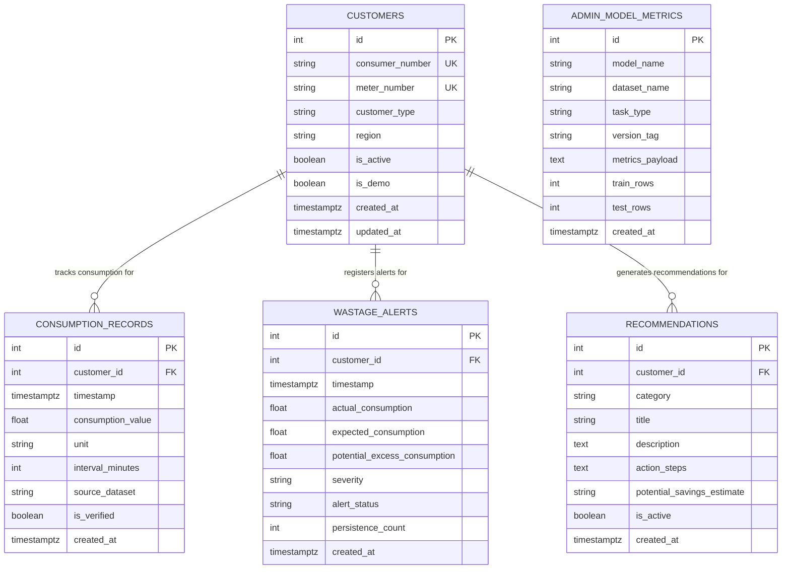

# WattSense AI™ — Relational Database Schema & Data Dictionary

**Document Reference**: `WATT-DOCS-DB-2026`  
**Database Engine**: PostgreSQL 18.4 (Development Fallback: SQLite 3)  
**Schema Version**: Alembic Revision `207fa595bbc0`  
**Verified Record Inventory**: **1,024 Records** across all tables  

---

## 1. Entity-Relationship (ER) Diagram

---

## 2. Table Specifications & Data Dictionary

### 2.1 Table: `customers`
Stores customer account and metering metadata. Personally Identifiable Information (PII) such as personal names, phone numbers, and physical addresses are strictly excluded from the schema to preserve privacy.

| Column | Type | Constraints | Description |
| :--- | :--- | :--- | :--- |
| `id` | Integer | PRIMARY KEY, Auto-increment | Unique system surrogate key |
| `consumer_number` | VarChar(64) | UNIQUE, NOT NULL, Indexed | Utility consumer identifier (e.g. `CONS-RES-1001`) |
| `meter_number` | VarChar(64) | UNIQUE, NOT NULL | Physical smart meter serial number (e.g. `MTR-90812-N`) |
| `customer_type` | VarChar(32) | NOT NULL | Category: `Residential` or `Commercial` |
| `region` | VarChar(64) | NOT NULL | Grid distribution district (e.g. `North Grid District`) |
| `is_active` | Boolean | DEFAULT True | Operational connection status flag |
| `is_demo` | Boolean | DEFAULT False | Distinguishes synthetic demonstration profiles from production accounts |
| `created_at` | Timestamp with TZ | DEFAULT NOW() | Record creation timestamp |
| `updated_at` | Timestamp with TZ | DEFAULT NOW() | Record modification timestamp |

### 2.2 Table: `consumption_records`
Stores high-resolution smart meter consumption readings. Indexed on `(customer_id, timestamp)` for high-throughput time-window extraction.

| Column | Type | Constraints | Description |
| :--- | :--- | :--- | :--- |
| `id` | Integer | PRIMARY KEY, Auto-increment | Record primary key |
| `customer_id` | Integer | FOREIGN KEY (`customers.id`), NOT NULL | Owning customer foreign key |
| `timestamp` | Timestamp with TZ | NOT NULL, Indexed | Telemetry recording timestamp |
| `consumption_value`| Float | NOT NULL | Metered electrical energy (kWh) |
| `unit` | VarChar(16) | DEFAULT 'kWh' | Measurement unit |
| `interval_minutes` | Integer | DEFAULT 60 | Telemetry sampling interval duration |
| `source_dataset` | VarChar(64) | NOT NULL | Telemetry provenance tag (`UCI_REAL`, `DEMO_SYNTHETIC`) |
| `is_verified` | Boolean | DEFAULT True | Quality-assurance validation flag |

### 2.3 Table: `wastage_alerts`
Records verified excess consumption events emitted by the persistence filtering service.

| Column | Type | Constraints | Description |
| :--- | :--- | :--- | :--- |
| `id` | Integer | PRIMARY KEY, Auto-increment | Alert primary key |
| `customer_id` | Integer | FOREIGN KEY (`customers.id`), NOT NULL | Owning customer foreign key |
| `timestamp` | Timestamp with TZ | NOT NULL | Start of anomalous sustained draw |
| `actual_consumption`| Float | NOT NULL | Metered consumption value (kWh) |
| `expected_consumption`| Float | NOT NULL | Statistical expected baseline (kWh) |
| `potential_excess_consumption`| Float | NOT NULL | Calculated excess: $\max(0, \text{actual} - \text{expected})$ |
| `severity` | VarChar(16) | NOT NULL | Alert tier: `LOW`, `MEDIUM`, or `HIGH` |
| `alert_status` | VarChar(16) | DEFAULT 'NEW' | Workflow state: `NEW`, `ACKNOWLEDGED`, `RESOLVED` |
| `persistence_count`| Integer | DEFAULT 1 | Consecutive intervals meeting anomaly criteria |

---

## 3. Seeded Demonstration Inventory

| Table | Record Count | Description |
| :--- | :---: | :--- |
| `customers` | **3** | Demonstration profiles: `CONS-RES-1001`, `CONS-RES-2002`, `CONS-COM-3003` |
| `consumption_records` | **1,008** | 336 hourly readings per customer across 14 consecutive days |
| `wastage_alerts` | **5** | High-wastage alerts on `CONS-RES-2002` (`persistence_count = 6`, 1.22 kWh excess each) |
| `recommendations` | **4** | Tailored recommendations for energy optimization |
| `admin_model_metrics` | **4** | Benchmarks for forecasting models ($h=1, 6, 144$) and baselines |
| **Total** | **1,024** | **Verified intact in PostgreSQL 18.4** |
