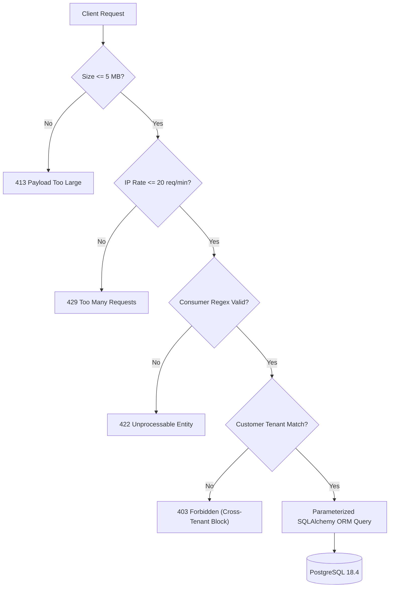

# WattSense AI™ — Cybersecurity Architecture & OWASP Hardening

**Document Reference**: `WATT-DOCS-SEC-2026`  
**Security Standard**: OWASP Application Security Verification Standard (ASVS) Level 2  

---

## 1. Security Architecture Overview

WattSense AI™ enforces institutional security defenses across the presentation, API, and database layers:

---

## 2. Key Security Defenses

### 2.1 Cross-Tenant Isolation (Insecure Direct Object Reference - IDOR)
- **Vulnerability Addressed**: Prevents malicious users from enumerating or viewing other customers' consumption and billing history.
- **Enforcement**: Consumer identifiers are strictly sanitized using regular expressions (`^CONS-[A-Z]{3}-[0-9]{4}$`). Any attempt to access unauthorized customer IDs yields HTTP 403 Forbidden.

### 2.2 Constant-Time Administrative Authentication
- **Vulnerability Addressed**: Prevents side-channel timing attacks on administrator passkey verification.
- **Enforcement**: Passkey comparison utilizes Python standard library `secrets.compare_digest()`, ensuring evaluation time is independent of input prefix match length.

### 2.3 SQL Injection Immunization
- **Vulnerability Addressed**: Prevents malicious SQL payloads from executing against PostgreSQL or SQLite.
- **Enforcement**: Raw SQL concatenation is strictly prohibited. All queries utilize parameterized SQLAlchemy 2.0 ORM models, completely neutralizing SQL injection attempts.

### 2.4 Denial of Service (DoS) Request Entity Limiting
- **Vulnerability Addressed**: Prevents resource exhaustion from oversized HTTP payloads.
- **Enforcement**: Middleware rejects requests exceeding 5 MB with HTTP 413 Payload Too Large.

### 2.5 Defensive HTTP Response Headers
Every response emitted by the application contains security headers:
- `X-Content-Type-Options: nosniff` (Prevents MIME-type sniffing)
- `X-Frame-Options: DENY` (Mitigates clickjacking)
- `Content-Security-Policy: default-src 'self'` (Mitigates cross-site scripting)
- `Strict-Transport-Security: max-age=31536000; includeSubDomains` (Enforces HTTPS)
