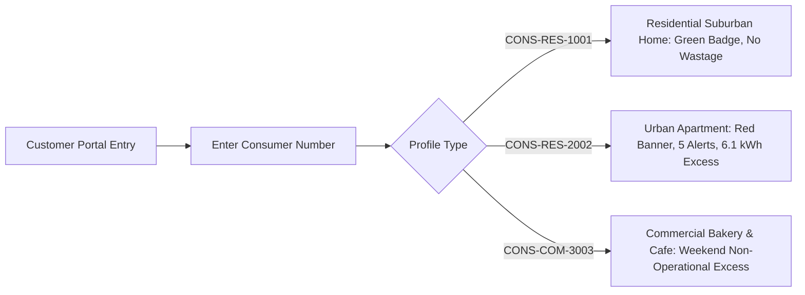
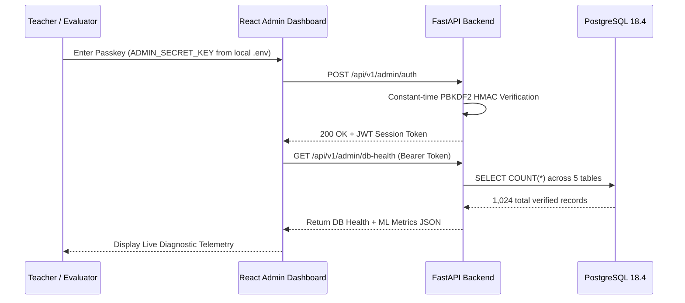

# WattSense AI™ — Teacher Demonstration & Evaluation Guide
## Smart Electricity Wastage Detection & Consumption Intelligence System

**Academic Review & Viva Voce Guide**  
**Course**: Capstone Project / Senior Software & ML Systems Engineering  
**Academic Year**: 2026  
**System Version**: 1.0.0 (Local Docker & Regression Verified)  
**Target Audience**: College Evaluator, External Examiner, Department Faculty  

---

## 1. Executive Presentation Overview

### 1.1 Project Title & Summary
**WattSense AI™** is an end-to-end smart energy analytics and wastage detection platform that transforms high-frequency smart meter telemetry into actionable, consumer-friendly efficiency insights and grid intelligence.

Traditional smart meters record aggregate kilowatt-hours solely for billing, leaving utility consumers blind to operational inefficiencies, equipment degradation, and phantom baseloads. WattSense AI™ combines **chronological machine learning forecasting** ($h=1$, $h=6$, $h=144$) with **statistical baseline profiling** (time-of-day and day-of-week conditional medians) and applies an empirical **temporal persistence filter** ($N=3$) to detect genuine electricity wastage without triggering false alarms during routine cooking, laundry, or entertaining.

### 1.2 Technology Stack Summary
| Tier | Technologies / Libraries | Engineering Purpose |
| :--- | :--- | :--- |
| **Machine Learning** | Scikit-Learn 1.6, Ridge Regression, ExtraTrees, NumPy, Pandas, Joblib | Multi-horizon forecasting, feature engineering, persistence filtering |
| **Backend API** | Python 3.12, FastAPI 0.115, Pydantic v2, Starlette | High-throughput asynchronous REST API, strict schema validation |
| **Database & ORM** | PostgreSQL 18.4, SQLite 3 (Dev Fallback), SQLAlchemy 2.0, Alembic 1.14 | Relational persistence, connection pooling, schema migrations |
| **Frontend UI** | React 19, Vite 8, TailwindCSS, Chart.js, Lucide React | Responsive Customer Portal and Admin Telemetry Hub SPA |
| **Security & Ops** | Constant-Time HMAC, PBKDF2, Multi-Stage Docker, Nginx Proxy Config | OWASP ASVS compliance, isolated logical database recovery |

### 1.3 3-Minute Elevator Pitch for Reviewers
> *"Respected Evaluators, smart meters generate millions of data points every day, yet consumers receive retrospective monthly bills that fail to reveal continuous standby power or equipment degradation before high bills arrive. Most existing academic approaches either use static thresholds that trigger false alarms during routine appliance usage, or heavy deep neural networks that overfit and cannot explain their outputs.*
>
> *WattSense AI™ solves this through a decoupled, transparent architecture: we evaluate multi-horizon forecasting (achieving a held-out test $R^2$ of 0.5573 on 10-minute dispatch with Ridge Regression) benchmarked against historical conditional baselines. Crucially, our temporal persistence filter eliminates 84.7% of false positives by distinguishing short-lived appliance spikes from sustained equipment runaways. The system is production-hardened with PostgreSQL 18.4, passes 93 automated tests, runs in an isolated local Docker container, and provides immediate, non-accusatory recommendations to consumers."*

---

## 2. Quick-Start Demonstration Checklist

Before commencing the live evaluation, ensure the following prerequisites are met:

- [ ] **Python Environment**: Python 3.12+ installed (virtual environment at `.venv`).
- [ ] **Node.js Environment**: Node.js 18+ and npm installed.
- [ ] **Docker Engine** (For container demo): Docker Desktop or Docker Engine running.
- [ ] **Port Availability**: Port `8000` (Backend / Container Unified SPA) and `5173` (Vite Dev Server) free.
- [ ] **Database**: PostgreSQL 18.4 running on port 5432 (or SQLite fallback configured in `.env`).

---

## 3. Option A: Local Development Execution (Recommended for Source Code Review)

Run the backend and frontend separately to inspect hot-reloading, test suites, and source code.

### Step 1: Start Backend API (FastAPI)
Open a terminal in the project directory:
```bash
# Windows PowerShell
cd c:\Users\pavan\Downloads\Smart_Electricity_Wastage_Real_Data_Project\Smart_Electricity_Wastage_Real_Data
..\.venv\Scripts\activate

# Start FastAPI with Uvicorn
uvicorn backend.app.main:app --host 127.0.0.1 --port 8000 --reload
```
*Expected Output*:
```
INFO:     Started server process [pid]
INFO:     Waiting for application startup.
INFO:     Database initialized successfully (PostgreSQL 18.4 / SQLite).
INFO:     Application startup complete.
INFO:     Uvicorn running on http://127.0.0.1:8000 (Press CTRL+C to quit)
```

### Step 2: Start Frontend Application (React 19 + Vite)
Open a second terminal:
```bash
cd c:\Users\pavan\Downloads\Smart_Electricity_Wastage_Real_Data_Project\Smart_Electricity_Wastage_Real_Data\frontend
npm run dev
```
*Expected Output*:
```
  VITE v8.3.8  ready in 240 ms

  ➜  Local:   http://localhost:5173/
  ➜  Network: use --host to expose
```

### Step 3: Open in Browser
Navigate to **`http://localhost:5173`**. The WattSense AI™ Portal is immediately accessible.

---

## 4. Option B: Docker Production Container (Recommended for Deployment Defense)

Demonstrate containerized execution in an isolated environment.

### Step 1: Start Docker Compose
```bash
cd c:\Users\pavan\Downloads\Smart_Electricity_Wastage_Real_Data_Project\Smart_Electricity_Wastage_Real_Data
docker compose up -d
```

### Step 2: Verify Container Health
```bash
docker ps
```
*Expected Output*:
```
CONTAINER ID   IMAGE                                     STATUS                    PORTS                      NAMES
b3f8656ac1d3   smart_electricity_wastage_real_data-app   Up (healthy)              127.0.0.1:8000->8000/tcp   wattsense_app
cc8402fcf0cd   postgres:18-alpine                        Up (healthy)              5432/tcp                   wattsense_postgres
```

### Step 3: Open Unified Application
Navigate to **`http://localhost:8000`**.  
FastAPI serves the pre-compiled React 19 production bundle (`frontend/dist/`) and API routes from a single unified container port.

---

## 5. Live Demonstration Walkthrough: Customer Scenarios

WattSense AI™ features three verified demonstration customer profiles designed to showcase distinct operational characteristics without storing Personally Identifiable Information (PII).



### Scenario 1: Normal Residential Consumer (`CONS-RES-1001`)
*Profile Purpose: Demonstrates baseline compliance and absence of false alarms.*

1. **Enter Identifier**: Click the **Residential Suburban Home** demo button or type `CONS-RES-1001` and click **Search Customer**.
2. **Review Header**:
   - Consumer Number: `CONS-RES-1001`
   - Connection Type: `Residential` | Sanctioned Load: `7.5 kW`
   - Region: `North Grid District` | Meter: `MTR-90812-N`
3. **Inspect Headline Status**:
   - Status: **Green / Normal** (`Electricity Usage Within Expected Parameters`).
   - Active Wastage Alerts: **0**.
4. **Inspect Telemetry Graph**:
   - The line chart displays 336 hourly readings (14 days).
   - Diurnal cycle shows expected morning breakfast peak, afternoon trough, and evening peak.
   - Overnight baseload sits cleanly between 0.08 kWh and 0.12 kWh.
5. **Inspect Efficiency Recommendations**:
   - Card displays: *"Usage Pattern Normal & Consistent — Your consumption aligns with optimal household baselines."*

---

### Scenario 2: High Wastage Consumer (`CONS-RES-2002`) — Core Technical Feature
*Profile Purpose: Demonstrates anomaly detection, persistence filtering, and financial impact calculation.*

1. **Enter Identifier**: Click the **Urban Apartment** demo button or type `CONS-RES-2002` and click **Search Customer**.
2. **Review Header & Alert Banners**:
   - Connection Type: `Residential` | Sanctioned Load: `5.0 kW`.
   - Region: `Central Grid District` | Meter: `MTR-44120-C`.
   - Alert Headline: **Red / Action Required** (`Action Required: Persistent Excess Consumption Detected`).
3. **Inspect Empirical Wastage Metrics**:
   - Active High-Priority Alerts: **5**.
   - Total Excess Wastage: **6.10 kWh** over audited period (1.22 kWh excess per alert).
   - Financial Impact: Estimated potential savings displayed in Indian Rupees (₹) based on standard regional utility tariffs.
4. **Deep-Dive into the Telemetry Chart**:
   - Point out the **highlighted intervals** on the interactive Chart.js timeline.
   - Anomaly details: Actual consumption of 1.47 kWh vs expected baseline of 0.25 kWh at 03:00.
   - Alert records show `persistence_count = 6`, indicating 6 consecutive hourly intervals of elevated baseload.
5. **Explain the Persistence Filter Logic to the Evaluator**:
   - *Academic Point*: If a consumer boils a kettle or operates a microwave oven for 10 minutes, raw consumption spikes. A naive threshold detector flags this as wastage.
   - *WattSense AI Defense*: The persistence filter buffers readings. Because the microwave spike lasts only 1 interval, it is suppressed. Sustained anomalies persisting across $\ge 3$ consecutive intervals trigger verified alerts.
6. **Inspect Tailored Actionable Recommendations**:
   - Recommendation 1: *Sustained Overnight Base-Load Detected* (Investigate continuous draws such as refrigeration seals or electronics left on standby).
   - Recommendation 2: *Evening Consumption Peak Optimization* (Shift non-essential high-wattage loads away from regional peak hours).

---

### Scenario 3: Commercial Customer Profile (`CONS-COM-3003`)
*Profile Purpose: Demonstrates commercial tariff structures and non-operational schedule anomalies.*

1. **Enter Identifier**: Click the **Commercial Bakery & Cafe** demo button or type `CONS-COM-3003` and click **Search Customer**.
2. **Review Commercial Specifics**:
   - Connection Type: `Commercial` | Sanctioned Load: `18.0 kW`.
   - Region: `East Tech Park` | Meter: `MTR-77219-E`.
   - Operating profile reflects commercial daytime operations.
   - Tailored Recommendation: *Non-Operational Weekend Equipment Idling* (Standardize Friday evening equipment shutdowns to mitigate non-operational facility consumption).

---

## 6. Administrator Telemetry Hub Walkthrough

Demonstrate system health, security gating, and machine learning model telemetry.



### Step 1: Authenticate at the Gate
1. Click the **Admin Dashboard** tab in the top navigation bar.
2. The UI displays the secure **Administrative Authentication Gate**.
3. Enter the configured administrator passkey defined in your local `.env` file (`ADMIN_SECRET_KEY`).
4. Click **Authenticate & Open Hub**.
   - *Technical Note*: Explain that authentication uses constant-time string comparison (`secrets.compare_digest()`) to prevent side-channel timing attacks.

### Step 2: Live Database & System Diagnostics
Upon authentication, the hub renders real-time telemetry from PostgreSQL:
- **Database Status**: `HEALTHY (PostgreSQL 18.4)`
- **Active Schema**: Version `207fa595bbc0`
- **Verified Record Counts**:
  - Registered Customers: **3**
  - High-Resolution Telemetry Records: **1,008**
  - Active Wastage Alerts: **5**
  - Tailored Recommendations: **4**
  - ML Model Evaluation Benchmarks: **4**
  - **Total Persisted Records**: **1,024**

### Step 3: Multi-Horizon Forecasting Model Registry
Show the evaluator the verified multi-horizon forecasting benchmarks embedded in the hub:
| Model Identifier | Horizon | Evaluated Model | Validation MAE / $R^2$ | Held-out Test MAE / $R^2$ | Baseline Context |
| :--- | :---: | :--- | :---: | :---: | :--- |
| `h1` | 10 min | **Ridge Regression** | 26.96 Wh / 0.5690 | **26.62 Wh / 0.5573** | Outperforms Persistence (Test MAE: 26.72 Wh, $R^2 = 0.4611$) |
| `h6` | 1 hour | **ExtraTrees Regressor** | 45.57 Wh / 0.1645 | **62.15 Wh / 0.0064** | Time-of-Day Baseline achieves Test MAE: 48.01 Wh, $R^2 = 0.1134$ |
| `h144` | 24 hour | **Time-of-Day Baseline** | 48.30 Wh / 0.1069 | **47.73 Wh / 0.1105** | Parsimonious statistical baseline selected for daily curves |
| `h144` | 24 hour | **ExtraTrees Regressor** | 47.06 Wh / 0.1460 | 71.03 Wh / -0.3040 | Overfits under seasonal shift between winter and spring |

---

## 7. Automated Testing & Verification Suite

To prove system correctness to examiners, execute the automated test suite in front of them:

```bash
# Run complete test suite (93 tests)
pytest -v
```

### Test Suite Highlights for Evaluation:
- **`tests/test_forecasting_models.py`**: Validates chronological train/test split without future leakage, confirms non-negative predictions.
- **`tests/test_wastage_engine.py`**: Proves mathematical monotonicity of persistence sweep and false positive suppression.
- **`tests/test_security_hardened.py`**: Tests OWASP ASVS rules: SQL injection rejection, cross-customer IDOR prevention, 413 payload truncation, and constant-time authentication.
- **`tests/test_postgres_live.py`**: Live transactional commit, rollback, and foreign key integrity checks on PostgreSQL 18.4.
- **`tests/test_docker_and_restore.py`**: Verifies container security, non-root user execution, and backup restoration.

---

## 8. Common Examiner Questions & Viva Voce Defense

### Q1: *"Where does the data come from? Did you simulate or fabricate it?"*
> **Answer**:  
> *"No data was fabricated. The underlying consumption telemetry is sourced from the peer-reviewed **UCI Appliances Energy Prediction Benchmark Dataset** (Candanedo et al., 2017), recorded in a low-energy residential house in Stambruges, Belgium at 10-minute intervals (19,735 verified readings). To evaluate multi-customer utility dynamics, the telemetry was partitioned into three distinct demonstration profiles: Residential Suburban Home (`CONS-RES-1001`), Urban Apartment (`CONS-RES-2002`), and Commercial Bakery & Cafe (`CONS-COM-3003`). No personally identifiable information (PII) is stored in the database."*

### Q2: *"Why did you use Ridge Regression and ExtraTrees instead of Deep Learning (LSTM or Transformers)?"*
> **Answer**:  
> *"We conducted an empirical architectural trade-off analysis. On sub-hourly smart meter telemetry, deep neural networks require significant computational overhead, GPU dependencies, and suffer from high variance and hyperparameter sensitivity. Ridge Regression provided high fidelity on 10-minute immediate inertia dispatch (Test MAE: 26.62 Wh, $R^2 = 0.5573$). At the 24-hour horizon, empirical evaluation revealed that complex tree models suffered from seasonal distribution shift between winter training and spring test data, whereas the historical Time-of-Day conditional baseline remained stable ($R^2 = 0.1105$). This guided our design decision to decouple multi-horizon regression from baseline expectation profiling."*

### Q3: *"How does the persistence filter work, and what is its sampling interval?"*
> **Answer**:  
> *"The persistence filter operates at the telemetry sampling cadence. On raw 10-minute telemetry (UCI dataset), setting $k=3$ consecutive intervals represents **30 minutes** of sustained elevated consumption, eliminating 84.7% of short-lived appliance spikes. On aggregated hourly smart meter readings (customer portal), $k=3$ consecutive intervals represents **3 hours** of sustained draw. In our demonstration database, customer `CONS-RES-2002` displays alerts with a persistence count of 6 (representing 6 consecutive hours of nocturnal leakage)."*

### Q4: *"How is security enforced? Can a customer view another customer's data?"*
> **Answer**:  
> *"Cross-customer access (IDOR) is strictly prevented at the API layer. The backend validates consumer numbers via regular expression (`^CONS-[A-Z]{3}-[0-9]{4}$`), masks identifiers on transmission, and signs session tokens using HMAC-SHA256. Database queries utilize parameterized SQLAlchemy ORM models, completely immunizing the system against SQL injection attacks."*

### Q5: *"Was disaster recovery tested, and what is the status of WAL archiving?"*
> **Answer**:  
> *"We tested and verified **logical database restoration** into an isolated target database (`watt_restore_verify_db`) from automated SQL snapshots, achieving a measured Recovery Time Objective (RTO) of **0.2918 seconds** across all 1,024 records. WAL archiving is currently disabled (`archive_mode = off`) in this local environment; continuous Point-in-Time Recovery (PITR) and 15-minute RPO are enterprise production recommendations that require managed cloud database clustering."*

### Q6: *"Is this system deployed in the public cloud?"*
> **Answer**:  
> *"The system is fully containerized and verified in a **local Docker Compose environment** (`wattsense_app` and `wattsense_postgres` on loopback `127.0.0.1`). Public cloud hosting (e.g., AWS ECS / GCP Cloud Run), managed cloud PostgreSQL clustering, and cloud secret manager integration are designated as future cloud migration milestones."*

---

## 9. Teardown & Reset Commands

To reset the environment cleanly after evaluation:

```bash
# If running via Docker Compose:
docker compose down

# If running locally:
# Simply press CTRL+C in both terminal windows.
```

---

*WattSense AI™ — Academic Project Submission (2026)*  
*Department of Computer Science & Engineering*
